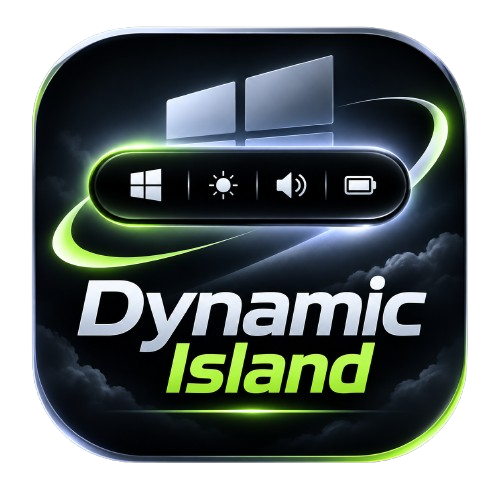

# Dynamic Island

### A smarter desktop experience for Windows.

Dynamic Island brings a modern, interactive island-style interface to your Windows desktop, making everyday system interactions feel more accessible and visually engaging.

Designed with simplicity and a clean visual style in mind, it adds a compact experience to your desktop without getting in the way of your workflow.

---

## Preview

  

---

## About the Project

Dynamic Island is a Windows desktop application built to provide a more modern way to interact with selected system features through an island-inspired interface.

The goal is simple: bring a clean, lightweight, and visually appealing experience to the Windows desktop.

## Features

- Modern Dynamic Island-inspired interface.
- Clean and minimal desktop design.
- Windows startup integration.
- Easy installation through a dedicated Windows installer.
- Designed to run conveniently in the background.

*Features and availability may vary depending on the application version.*

## Installation

Getting started is simple.

1. Open the [Releases](../../releases) page.
2. Download the latest `DynamicIsland_Setup.exe`.
3. Run the installer.
4. Follow the installation instructions.
5. Launch Dynamic Island and enjoy!

## System Requirements

- **Operating System:** Windows
- **Architecture:** 64-bit Windows recommended.

## Download

  <a href="../../releases/latest">
    <strong>Download the Latest Version</strong>
  </a>

Visit the Releases section to find the latest installer and version updates.

## Updates

New versions and improvements will be published through GitHub Releases.

Make sure to check the Releases page regularly to stay up to date.

## Developer

**PeterParker**

Created with attention to detail and a passion for building useful desktop software.

---

  Made By PeterParker 🕷️

